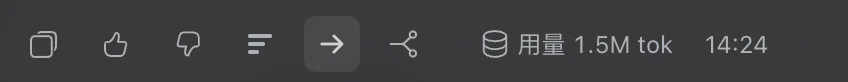

# dsh-ask-reader

A right-Sidebar **reading board** for DeepSeek Harness. Pin one of the assistant's replies into the right column, read it as rendered Markdown beside the conversation, then select the part you do not understand and send it back into the main composer as a quote.

## Screenshots

The entry point — the arrow action in the row under a finished reply (the label appears on hover):



## Why

Long answers are easier to work through beside the chat than in it: the board keeps one reply visible while you scroll the conversation, and asking about a specific sentence is one gesture instead of retyping it.

## Use

1. **Pin.** Under any finished assistant reply, click the arrow icon (hover shows “Pin to reading board”). The right column opens on the **Reading board** tab.
   - Or open the board from the arrow icon in the session header, and paste arbitrary text with **+ Paste text** at the bottom of the panel.
2. **Read.** Pins render as Markdown — headings, lists, blockquotes, tables, fenced code, bold/italic/inline code/links — not as source. Cards are expanded in full; **Collapse** folds one back to a preview.
3. **Ask.** Drag-select a passage; a blue pill **→ Send to chat** appears once the selection is released. Clicking it puts that passage into the main composer as a Markdown quote — add your question and send. Without a selection, **Ask** on the card quotes the whole pin.

## Behaviour

- Pins live in browser `localStorage`, one set per session; a reload keeps them, clearing site data removes them.
- Pins hold at most 40 entries per session; the oldest is dropped past that.
- Quotes are capped: 2000 characters from a reply (that reply is already in the session log), 6000 from a pasted excerpt. The overflow is marked `… (truncated)`.
- Only the session on screen has a composer. Where it is unavailable, the panel copies the passage to the clipboard and says so instead.
- The Markdown renderer is the plugin's own and deliberately small: no math, no Mermaid, no raw HTML, no images. Those show as text.

## Install

```sh
dsh plugin --profile <profile> add github:zbh13782-lang/dsh-ask-reader
```

Or, in DSH Desktop, **Settings → Plugins → Add plugin** and paste the repository URL. The package declares `dsh.bundle`, ships no dependencies and needs no build step.

## Layout

| Path | Role |
| --- | --- |
| `client.js` | The whole browser half: tab type, panel body, Markdown renderer, reply action, header entry |
| `index.js` | Host half (empty — the bundle row needs a module) |
| `cordis.patch.yml` | Loader row inserted by the bundle |
| `locale/*.json` | Plugin Manager title/description |
| `docs/DETAIL.md` | The detail page shown in Plugin Manager |

## Licence

MIT.